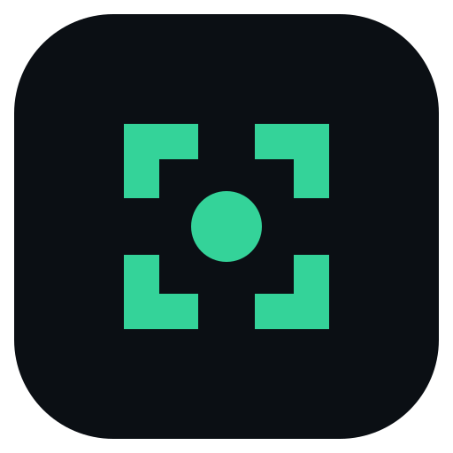

<p align="center">
  
</p>
<h1 align="center">hand</h1>
<p align="center"><strong>One MCP server for the headless browser and the Windows desktop: the Gladius and Puppet engines under one stdio connection, with targets an agent can mean and refusals that say why.</strong></p>

## Install

The published package is the official route. No compiler, no build tree:

```powershell
npx -y hand-mcp@0.1.0 --version
```

Point your MCP client at the package:

```jsonc
{
  "mcp": {
    "servers": {
      "hand": {
        "type": "local",
        "command": ["cmd", "/c", "npx", "-y", "hand-mcp@0.1.0"]
      }
    }
  }
}
```

The client spawns npx, which runs the bundled binary and speaks newline-delimited JSON-RPC 2.0 on stdio. stdout carries protocol frames only; diagnostics go to stderr.

From source, for development:

```powershell
cargo build --release
.\target\release\hand.exe doctor    # build, pinned engines, browser path; changes nothing
```

Point the client at `.\target\release\hand.exe mcp` (or `hand` on PATH) and restart it.

`node scripts/verify-install.mjs` proves the installed bytes are the commit you built; `--loaded` proves a process is actually serving that file. `node npm/release.mjs --check` proves the packaged artifact from its own bytes before anything is published.

## Use it

One connection, two domains, one budget, one shutdown. Browser tools carry the `browser_` prefix, desktop tools `desktop_`, and every legacy Gladius and Puppet tool body is the pin's, except the schema additions and the seven description rewrites declared in `baseline/declared-additions.json`: the name gained the prefix, the properties listed there were added (element and clip screenshots, right/double click, `resolved`, `noSteal`), and those seven descriptions were rewritten to document them. Any other body, title or description change fails. `tests/discovery.rs` asserts that against the committed floor, and `baseline/scripts/compare-catalog.mjs` recaptures the legacy catalog independently. That is the 32-tool compatibility floor, with hand's own `browser_context`, `browser_wheel` and `browser_drag` added on top - 35 tools live, and `baseline/hand-catalog.json` records both halves (`counts` for the floor, `live` for what this build publishes).

- Browser, 28 tools: `browser_navigate`, `browser_snapshot`, then a tool that acts on an `@eN` ref - click (with `button` and `clickCount` for right, middle and double clicks), type, hover, select, key, upload - plus `browser_wheel` and `browser_drag` for a trusted scroll and a trusted drag. Read with `browser_evaluate`, `browser_console`, `browser_network`, `browser_fetch_text`. Prove layout with `browser_wait_for`, `browser_assert_layout`, `browser_layout`; take pixels with `browser_screenshot` (whole page, one element, or a clip rectangle, as png/jpeg/webp), `browser_visual`; keep state with `browser_storage`; reach the protocol through `browser_cdp`.
- Desktop, Puppet's seven, `desktop_screenshot` through `desktop_elements`: Win32 plus UI Automation, reading or acting only on an explicitly selected window.
- Isolation: `browser_context` creates and selects named contexts so cookies and storage stay apart; a hidden desktop launch runs in a job object that dies with the server.

Two properties the tools keep:

- **Control with evidence.** A desktop action is posted to the chosen window: no global mouse, no physical pointer movement, no window activation, no clipboard write. A capture states the backend it used, the window it matched, whether the frame was blank or stale, and whether the foreground window and cursor stayed put. An observation that cannot be trusted fails instead of being reported as a picture.
- **Refusals that name the reason.** Cancellation and budget expiry answer `outcome: unknown` with `retry: unsafe` instead of implying the work stopped, and an unusable target returns a typed code beside the prose.

## Configure it

No flag serves MCP: `hand` with no argument is `hand mcp`. The other subcommands are `doctor`, `--version` and `--help`.

| Variable | Default | Effect |
|---|---|---|
| `GLADIUS_CDP_URL` | unset | Attach to an engine you already run instead of launching one. hand does not launch, kill or sweep it, and closes only pages it created. |

With no override, `browser_*` launches the pinned `chrome-headless-shell` from the per-user cache under `gladius/chromium/<pin>` on first use, in a private temporary profile, attached to a kill-on-close job.

## Requirements

- Windows 10/11 x64. The desktop domain is Win32 and UI Automation; there is no other platform.
- An MCP client that speaks stdio.
- The first browser call provisions the pinned `chrome-headless-shell`; later runs reuse it. Rust is needed to build, not to run.

## Development

```powershell
cargo test                                  # hand end-to-end suite
cargo test -p browser-engine                # vendored Gladius unit tests
cargo test -p desktop-engine -- --skip live_ # vendored Puppet unit tests
node baseline/scripts/compare-catalog.mjs --serve target\debug\hand.exe --baseline hand
```

The live browser test starts a loopback fixture and drives inspect, act and verify; the desktop test enumerates real windows and inspects one read-only while the foreground window and pointer stay put. Vendored engine sources are MIT, pinned and listed in `THIRD-PARTY-NOTICES.md`; the only edits are visibility and two integration seams, each marked in place.

## Status

**Experimental** — pre-release; interfaces may change.

Three commits in this history carried the local harness seed: `a0bdbe5`, `3295432` and `f1013fa`. They remain reachable objects. Leaving them was deliberate: they contain no secret, and a copy of the seed is kept in the harness archive.

The repository is public and the package is published with that history. The seed files stopped being tracked at `f08da64`; the three earlier commits remain reachable and contain no secret.

## Links

- [Issues](https://github.com/nathwn12/hand/issues)
- [Releases](https://github.com/nathwn12/hand/releases)
- [Capabilities](docs/CAPABILITIES.md)
- [Compatibility](docs/COMPATIBILITY.md)
- [Third-party notices](THIRD-PARTY-NOTICES.md)
- [MIT](LICENSE)
