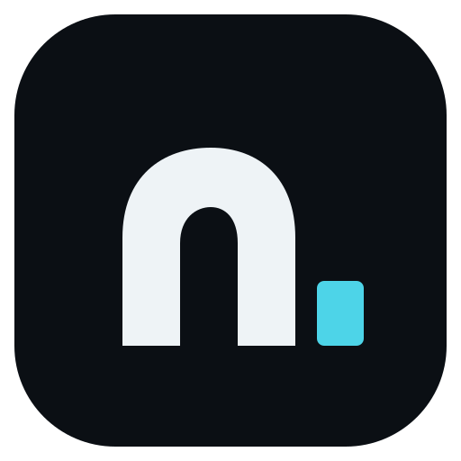

<h1 align="center">hand-mcp</h1>
<p align="center"><strong>The MCP server that can see and touch both the browser and Windows.</strong></p>

<p align="center">
  <a href="https://www.npmjs.com/package/hand-mcp"></a>
  
  
  
</p>

## Install

```powershell
npx hand-mcp
```

The binary ships inside the package: about 5 MB packed, 15 MB unpacked. No install script downloads anything and no compiler is needed. Pin an exact version (`npx hand-mcp@<version>`) when you need reproducibility.

A global install is not supported on purpose: the server belongs in the client's own process tree, not on `PATH`. `npx hand-mcp` needs none.

### Or let your AI install it

```text
Install nathwn12/hand (hand-mcp) with `npx hand-mcp`, then prove it works.
1. Run: `npx hand-mcp --version`
2. Done when: exit 0 and a line `hand <version> (<commit>; release)`.
3. Wire it: add the server below to the client config and restart.
If it fails, stop and paste the full output; do not improvise a fix.
```

### Wire it yourself

```jsonc
{
  "mcp": {
    "servers": {
      "hand": {
        "type": "local",
        "command": ["cmd", "/c", "npx", "-y", "hand-mcp"]
      }
    }
  }
}
```

The client spawns npx, which runs the bundled binary and speaks newline-delimited JSON-RPC 2.0 on stdio. stdout carries protocol frames only.

## What it does

One connection, two domains, 35 tools:

- **Browser, 28**: `browser_navigate`, `browser_snapshot` (stable `@eN` refs), click with right/middle/double, type, hover, select, key, upload, wheel, drag, evaluate, console, network, fetch text, wait, layout and layout assertions, visual regression, screenshots (whole page, one element, or a clip; png, jpeg, webp), storage, tabs, viewport, dialog, history, targets, named contexts, raw CDP, close.
- **Desktop, 7**: `desktop_screenshot`, `desktop_diff`, `desktop_list_windows`, `desktop_window`, `desktop_do`, `desktop_cursor`, `desktop_elements`, over Win32 and UI Automation.

A desktop action posts to the chosen window: no global mouse, no physical pointer movement, no window activation, no clipboard write. A refusal names its reason: a cancelled or expired call answers `outcome: unknown` with `retry: unsafe` instead of implying the work stopped. A healthy run writes nothing to the terminal.

## Configure it

| Variable | Default | Effect |
|---|---|---|
| `GLADIUS_CDP_URL` | unset | Attach to a browser you already run instead of launching one. hand does not launch, kill or sweep it, and closes only pages it created. |
| `HAND_DEBUG` | unset | Print engine diagnostics to stderr. Off by default. |

The first browser call provisions the pinned `chrome-headless-shell` into a per-user cache and reuses it after that.

## Requirements

- Windows 10 or 11, x64. The manifest declares `os: win32` and `cpu: x64`.
- Node 22.14.0 or newer, to run the launcher.
- An MCP client that speaks stdio.

## Status

**Experimental**: pre-release; interfaces may change.

## Links

- [Repository](https://github.com/nathwn12/hand)
- [Issues](https://github.com/nathwn12/hand/issues)
- [Releases](https://github.com/nathwn12/hand/releases)
- [MIT licence](https://opensource.org/license/mit)

<p align="center">
  
  <br />Built by nathwn12
</p>
